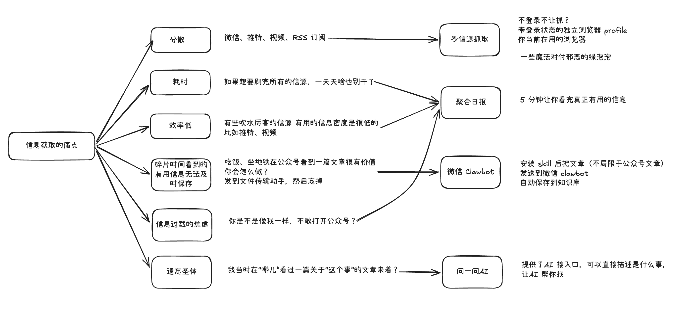
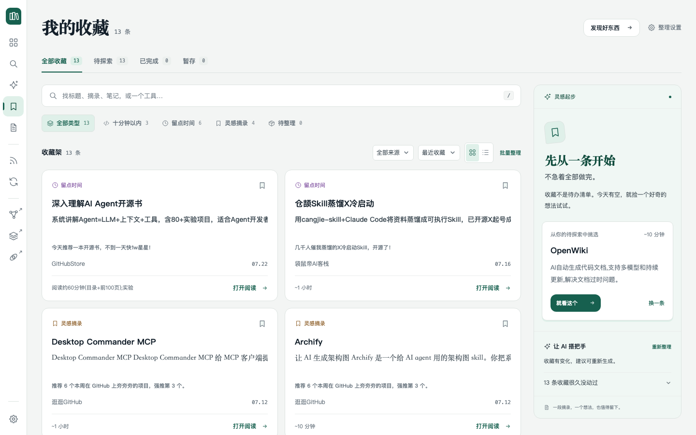
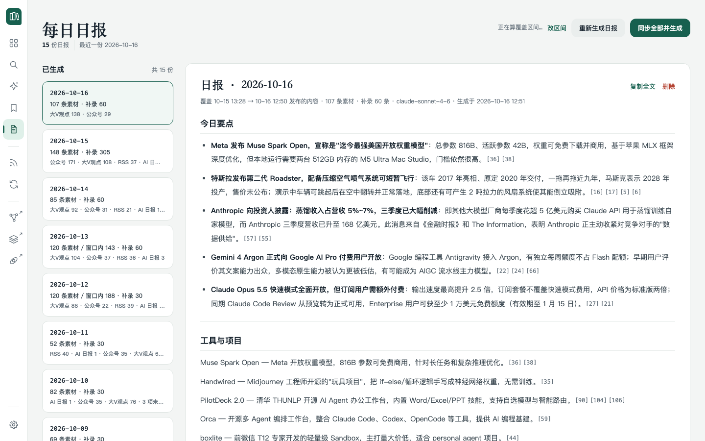
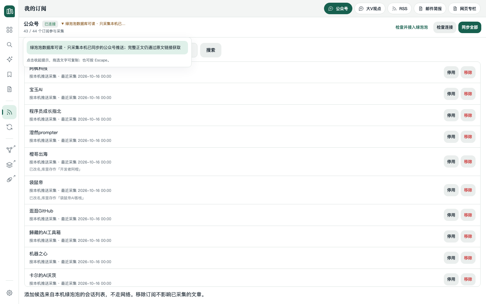

<h1 align="center">Knowbase</h1>

<p align="center">
  <strong>个人知识库 — 多来源聚合 · 混合检索 · 意图问答 · 每日日报</strong>
</p>

<p align="center">
  
  
  
  
</p>

---
<p align="center">
  
</p>

把绿泡泡、X 大V观点、RSS 订阅、网页专栏、简报、YouTube 视频摘要统一索引，支持关键词 + 语义混合检索、意图问答、每日日报、工具图鉴、收藏此段与 AI 分诊。

所有内容以 Obsidian vault 里的 Markdown 为事实来源，SQLite 只是索引（随时可删可重建）。

## 快速开始

```bash
# Mac 本机（推荐，可用绿泡泡采集）
./kb.sh start                   # 起面板 http://127.0.0.1:8787
./kb.sh sync                    # 跑全流程（采集→导出→索引→打标）

# Docker（索引和检索，不含绿泡泡采集）
docker compose up -d --build    # http://127.0.0.1:8787
```

打开面板后，首页会引导你完成两步初始配置：

1. **配置 API Key** — 设置菜单 →「API Key」，填入供应商的 key 和 base URL
2. **配置模型** — 设置菜单 →「模型配置」，为各个阶段（问答、提取、翻译、日报等）选择模型

配置完成后即可使用全部功能。绿泡泡采集还需要额外完成「绿泡泡接入」（见「我的订阅」一节）。

## 界面导览

打开 http://127.0.0.1:8787 ，左侧导航栏从上到下排列着七个面板，底部是设置菜单。

### 工具图鉴（首页）

默认打开的页面。把知识库里提取出的所有实体（开源项目、产品、模型、研究、公司）铺成卡片墙。

- **筛选和搜索**：顶部下拉框按类型、话题、来源过滤；搜索框支持模糊匹配
- **正字计数**：每张卡片上的「正」字笔画代表该工具在文章中被提及的次数
- **详情抽屉**：点击卡片打开右侧抽屉，看到摘要、全部标签和提到它的所有文章列表

### 全文检索

输入关键词，同时走 FTS（精确词匹配）和向量（语义相似）两路，用 RRF 融合排序。支持按来源、标签、实体名进一步过滤。搜索结果展示命中片段，点击跳转到原文阅读页。

### 知识问答

对话式问答。输入问题后，系统先用模型解析问题意图：

- **穷举类问题**（"最近一周都提过哪些开源项目"）→ SQL 全量聚合，一篇不漏
- **内容类问题**（"这个工具怎么用"）→ 混合检索 top-8 后综合回答

回答带 `[n]` 引用编号，点击可定位到原文出处。问答上下文由知识库提示词传入，不依赖供应商保存会话。

### 我的收藏

<p align="center">
  
</p>

**选中即收藏**：在知识库文章、日报、问答回答、订阅内容、图鉴条目里选中一段文字，浮动的「收藏此段」按钮就会出现。收藏时原样保存引文（保留换行缩进），并记录前后文锚点——之后在收藏列表里点击可跳回原文对应位置。

收藏架按状态管理：

| 状态 | 含义 |
|---|---|
| **inbox** | 待试——新收藏默认进这里，代表「看到了，还没动手」 |
| **done** | 已处理——试过了、读完了、记住了 |
| **archived** | 沉底——不想删但暂时不看（超过 60 天的 inbox 条目会提示一键沉底） |

**AI 加持**：
- **行动卡**：收藏的瞬间，后台自动调模型提炼出「这条收藏要你做的事」——工具名、要做什么、示例命令、预计时长
- **一键分诊**：点「AI 整理」，把所有 inbox 条目整体分成 hero（优先试）/ quick（5 分钟搞定）/ deep（需要深入）/ dup（重复）/ cold（过时）/ quotes（纯摘抄），帮你决定先动哪个
- 模型在收藏面板底部的「整理设置」里选

### 每日日报

<p align="center">
  
</p>

点「同步全部并生成」：先按你选择的来源范围跑一轮同步，再用入库内容生成日报。也可以点「直接生成」只用已有内容。

日报写进 `<vault>/daily/YYYY-MM-DD.md`，在 Obsidian 里也能直接打开。

- **时间窗口**：覆盖的是上一份日报截止到这一份生成那一段时间里**发布**的内容，不按自然日算，停了四天那一份就覆盖四天
- **补录**：发布时间更早、这一轮才抓进来的内容单独列一节「补录」，不会遗漏
- **定时**：底部可设每日定时生成（默认关闭），到点自动同步 + 出报
- **来源未成功提示**：有来源没同步到时日报照常出，但在完成提示、面板横幅、日报文件三处都会标明
- **引用**：综述中带 `[n]` 编号引用回原文
- 模型在设置菜单 →「模型配置」→「日报 · 当日综述」里选

### 我的订阅

<p align="center">
  
</p>

管理知识库的所有信息来源，按来源类型分栏显示。每个来源下有两个视图：

- **最新内容**：时间线展示已抓取的条目，点击在右侧阅读器中打开全文
- **文章排版**：正文与译文支持 Markdown 标题、列表、引用、代码和表格；长文提供可折叠目录，宽表格与长代码可单独横向滚动。短社交观点保留原始换行，文章原始文件不变。
- **订阅管理**：增删改订阅，支持单源同步、停用/启用

**Markdown 优先采集**：GitHub 仓库 README、GitHub 的 Markdown 文件页和直接的 `.md` 链接优先取 Markdown 原文；普通网页若明确返回 `text/markdown` 也直接保留，否则仍走网页正文提取。新订阅条目、手动抓取与正文重抓共用这套能力，失败时保留原有网页提取回退。翻译时隔离并原样还原代码块和其中的字符图，避免模型改乱缩进。已收录条目不会自动覆盖或重译，需要时从阅读区重新抓取。

支持的来源类型：

| 来源 | 特点 |
|---|---|
| **绿泡泡** | 读本机绿泡泡客户端已同步的推送，不需要凭证或代理 |
| **大V观点（X）** | 首次导入 51 个 X 账号，走登录态浏览器（独立 profile 或日常浏览器）或 feedgrab 取，也可给单账号填专用 feed 地址 |
| **RSS 订阅** | 首次导入 9 个订阅，标准 RSS/Atom |
| **网页专栏** | 给没有 RSS 的站点用（如 Anthropic news），自动识别文章列表页 |
| **简报** | TLDR AI 等汇总式简报，自动抓每期落地页的每条简讯正文 |

**英文自动翻译**：订阅类来源抓到的英文条目，在写入知识库前先整篇翻译成中文（标题和正文都译，专有名词保留原文）。中文内容直接跳过不花钱。每轮同步处理当前来源范围内全部待译条目，不设条数上限；保留 3 条并发与失败重试保护。尚未译完的内容不会以英文落盘，来源页面上会标注翻译状态。翻译模型在「模型配置」→「来源 · 英文内容翻译」里选。

**删除订阅**只会移除订阅关系，已收录的内容保留在知识库中。

#### 绿泡泡接入（首次）

<details>
<summary><strong>首次接入绿泡泡并采集公众号（点击展开）</strong></summary>

1. 在 **Mac 本机**运行本项目，登录本人的绿泡泡，并同步想采集的公众号推送。
2. 打开 **设置 → 绿泡泡接入**，点击 **「检查并接入绿泡泡」**（已接入时显示为 **「重新检查连接」**）。已有可用配置会直接复用，缺少读取工具时由系统自动准备。
3. 如果提示缺少 key，阅读影响说明并确认，再点击 **「自动获取 key 并验证」**，按提示完成系统授权；期间绿泡泡可能退出或重启。
4. 显示 **「已验证」** 后，点击 **「去同步公众号」**，选择公众号并开始同步。

也可以展开 **「方式二：让你的智能体协助接入」**，点击 **「复制接入提示词」**，交给 Mac 本机上能访问本项目和终端的智能体。处理完成后回到页面 **「刷新状态」**；获取 key 前仍需本人确认并完成系统授权。

首页引导和同步中心也可进入接入页面。无需额外安装 `wechat-intelligence-hub` 或其他 Skill；获取 key 和验证不使用大模型 API，也不向模型发送密钥。首次准备需要 `uv`、Go 和 Apple Command Line Tools。

> 仅采集本机已同步推送中的文章，正文需仍可访问；不代表能获取公众号全部历史。

</details>

<details>
<summary><strong>绿泡泡采集做了些什么</strong></summary>

这个项目为了把文章收进本地知识库，会在你这台机器上做下面几件事——影响范围比「一个检索工具」大得多：

- **请求 macOS 管理员授权，并以 root 运行 wxkey**（从固定源码构建）去提取**本机微信客户端的数据库密钥**。这个过程可能让微信退出或重启，并创建一份重签名副本。
- 用 **SQLCipher 只读打开解密后的消息库**，从里面发现图文推送（私聊、群聊不作为文章采集）。
- 按推送里的文章链接**批量抓取文章全文与图片**，存进本地 SQLite 和 Markdown。

**边界**

- **仅限你本人的微信账号，仅在你自己的本机运行。** 不要拿它去读别人的微信，也不要在别人的机器上跑。页面上那个勾选框（「这是我本人的微信」）不是形式——它就是这条边界本身。
- **抓下来的文章仅供个人存档与检索，不得再分发。** 文章的版权属于原作者。
- **使用者自行承担风险。** 批量抓取和读取本机客户端数据库可能违反微信的服务条款，也可能触及你所在地的法律法规（著作权、计算机信息系统、个人信息保护等）。是否使用、怎么用，由你自己判断并承担后果。
- **本项目不提供任何保证。** 按 [LICENSE](LICENSE) 的 MIT 条款，软件按「原样」提供，不保证可用性、正确性、数据不丢失，也不对任何直接或间接损失负责。
- 维护者**不会**为规避平台风控、绕过授权或抓取非本人账号的内容提供帮助。

不接受上面这些，就别用这个项目——只做索引和检索（不碰绿泡泡）的那部分可以单独用：把已有的 Markdown 目录挂给它，见「[Docker 部署](#docker-部署)」。

</details>

### 同步中心

一键触发全流程同步，或按来源单独跑：

**抓取** → **导出**（写入 vault Markdown）→ **索引**（FTS + 向量，增量）→ **提取**（entity / topic / 摘要 / 软广判定，标签自动回写 Obsidian frontmatter）

面板实时显示当前阶段、进度条、耗时。完成后各阶段汇报数字：新增多少、跳过多少、失败多少。

- **同步历史**：最近几轮运行记录保留，可展开查看每轮的详细数据
- **失败明细**：缺正文的条目可以点开原文核对，确认原文确实没有内容后可当场「不再抓取」
- **重试失败项**：一键按上次的失败状态重新编排（补正文 → 重建索引 → 重跑提取）
- **定时**：在日报面板里设置定时后，同步也会随日报一起自动跑

### 设置菜单（左下角）

| 入口 | 用途 |
|---|---|
| **模型配置** | 为每个阶段分别选模型（问答、提取、翻译、日报、收藏、wiki 等），按供应商分组 |
| **API Key** | 配置供应商的 key 和 base URL，支持 OpenAI 兼容协议的 Responses / Chat Completions 切换 |
| **MCP 连接** | 查看和配置 MCP server 连接状态 |
| **绿泡泡接入** | 首次接入采集（检查工具、获取数据库 key） |
| **键盘快捷键** | 查看所有键盘快捷操作 |

## 三张图谱

除了面板内的工具图鉴，知识库还生成三张独立的可视化图谱（单文件 HTML，可脱离面板直接在浏览器里打开）：

- **开源项目图谱** — 全量项目按用途分类，一屏看完你关注的所有开源工具
- **Skill 图谱** — 工具/技能条目按用途归类
- **话题图谱** — 最近两周在聊什么，实体共现网络

同步时自动重建。也可以手动 `./kb.sh graph` 立即重建（约 6 秒，零模型调用）。

## MCP（在 Claude Code / Desktop 里问知识库）

```bash
claude mcp add kb --scope user -- uv run --directory ~/code/knowbase kb-mcp
```

注册后可用工具：`kb_search`（混合检索）、`kb_enumerate`（全量枚举，穷举问题用这个）、`kb_read`（读全文）、`kb_entities`（列实体）。

### Skill：在对话里收录链接

仓库自带 skill `kb-grab`（`.claude/skills/kb-grab/`），和面板上「存入知识库」按钮走同一个接口。

**安装**：在仓库目录里的 Claude Code 会话天然可用，不需要装。要在其他项目里也能用，让 Claude 帮你装：

```
帮我把 ~/code/knowbase/.claude/skills/kb-grab 链接到全局 skill 目录
```

或者自己来：`ln -s ~/code/knowbase/.claude/skills/kb-grab ~/.claude/skills/kb-grab`。检出不在 `~/code/knowbase` 时设 `KB_HOME` 环境变量指向仓库根目录。

**使用**：用自然语言说一句就行，不需要记命令——

```
这篇存一下 https://example.com/post
把这几条收进知识库 https://a.com https://b.com
这篇我存过吗 https://example.com/post
刚存那篇不对，重新抓一次 https://example.com/post
```

Claude 看到你要往知识库存东西，会自动调这个 skill。

## CLI 用法

面板能做的事 CLI 也能做：

```bash
# 索引与提取
uv run kb index                # 扫 vault，增量索引 + 补向量（首次下载 bge-m3 ~2GB）
uv run kb index --no-vector    # 只建 FTS（快，不依赖模型）
uv run kb extract --limit 20   # LLM 提取（youtube 自带标签免提取）
uv run kb extract --writeback  # 提取并回写 tag 到 Obsidian frontmatter

# 检索与问答
uv run kb search "把书变成skill的工具"
uv run kb search "画图" --tag topic/skill工具
uv run kb search "xxx" --source dr-gzh --json
uv run kb ask "有没有能自动生成架构图的开源工具?"
uv run kb stats

# 服务管理
./kb.sh start | stop | restart    # 面板守护进程
./kb.sh sync                      # 全流程同步
./kb.sh sync --channel rss        # 只跑某一个来源
./kb.sh status                    # 一屏看全
./kb.sh graph                     # 重建三张图谱

# 手动收录（粘一条链接，内容抓进知识库）
./kb.sh grab https://example.com/post        # 收下来，并等它真写进知识库
./kb.sh grab --state https://example.com/p   # 只查这一条此刻的状态（只读）
./kb.sh grab --refetch https://example.com/p # 库里那一份不对时重抓、确认得了就换掉
pbpaste | ./kb.sh grab -                     # 从剪贴板那段文字里挑出链接收录
./kb.sh grab - < links.txt                   # 一行一条的清单：整行原样收，不做抽取
echo '见 <https://example.com/p;> 这篇' | ./kb.sh grab -   # 行文里圈出来的也原样收
echo '见 [原文](https://example.com/a_(b)) 这篇' | ./kb.sh grab -  # Markdown 按语法取目标

# 订阅管理
./kb.sh accounts list | discover | add | remove | enable | disable [名字]
```

`./kb.sh` 不带参数打印全部命令。每条命令跑完就还你终端，服务起成后台守护进程。

## Docker 部署

```bash
docker compose up -d --build
# 打开 http://127.0.0.1:8787，配置供应商和各阶段模型
docker compose logs -f --tail 100
```

默认使用持久卷。已有文章目录可在 `.env` 中配置 `KB_VAULT_PATH`（参考 `.env.example`），再 `docker compose exec knowbase kb index --no-vector` 建索引。

**绿泡泡采集只能在 Mac 本机跑**——推荐在 Mac 完成采集和导出，Docker 挂载文章目录做索引和检索。迁移和备份见 [Docker 部署说明](docker/README.md)。

## 跑测试

```bash
./kb.sh test             # 提交前的快速层:纯逻辑全量,浏览器回归显式拦下(约 4 分钟)
./kb.sh test probes      # 只跑浏览器回归 —— 改了 kb/static/ 或阅读页之后(约 8 分钟)
./kb.sh test full        # 真全量,push 前至少一次(约 12 分钟)
```

三层都把数据目录换成全新临时目录,不碰真实库;分层口径见
`docs/decisions/test-tiers.md`。等价的原始命令(CI 跑的就是这条):

```bash
# 知识库侧(约 3500 条)
uv run python -m unittest discover -s tests -t . -q

# 采集器侧（约 160 条）
cd collector && ./.venv/bin/python -m unittest discover -s tests -t . -q
```

不需要联网、不需要模型 key（大模型调用走本地桩）。浏览器回归要 `node` + `chrome-headless-shell`（`HEADLESS_SHELL=<路径>`）。lint：`uvx ruff@0.16.7 check .`。

## 架构

```
obs vault (事实来源, Markdown + frontmatter)
  ├── source/dr-gzh/          绿泡泡文章
  ├── source/dr-youtube-dig/  YouTube 摘要
  ├── source/social/          X 大V观点
  ├── source/rss/             RSS 订阅
  ├── source/web/             网页专栏
  ├── source/digest/          简报
  └── daily/                  每日日报 (不回索引)
        ↓ kb index                      ↓ kb extract
  SQLite (data/kb.db)           LLM (按阶段选模型)
  ├── documents / doc_tags     提取 entities/topics/summary/promo
  ├── chunks + FTS5(jieba)       ├→ 入库 → 图鉴卡片
  ├── chunk_vec (sqlite-vec,     └→ --writeback 回写 frontmatter
  │   bge-m3 本地 embedding)
  └── favorites (收藏/行动卡)
        ↓ kb search / kb ask
  FTS + 向量 → RRF 融合 → doc 聚合 [→ 模型综合回答]
```

知识库主干不认识任何具体来源，只认采集器契约（`kb/collectors/`）。新增来源写个实现即可，管道一行不改。来源扩展方法见 [来源模块设计](docs/source-modules.md)。

## 没有鉴权：默认只听回环

**kb-web 不做任何身份验证**——它唯一的保护是**默认只绑在回环地址上**（`KB_HOST` 默认 `127.0.0.1`）。要从别处访问就走 SSH 端口转发或自己带鉴权的反向代理。细节见 [SECURITY.md](SECURITY.md)。

## 许可

**MIT**

完整归属见 [NOTICE](NOTICE)，安全策略见 [SECURITY.md](SECURITY.md)。
