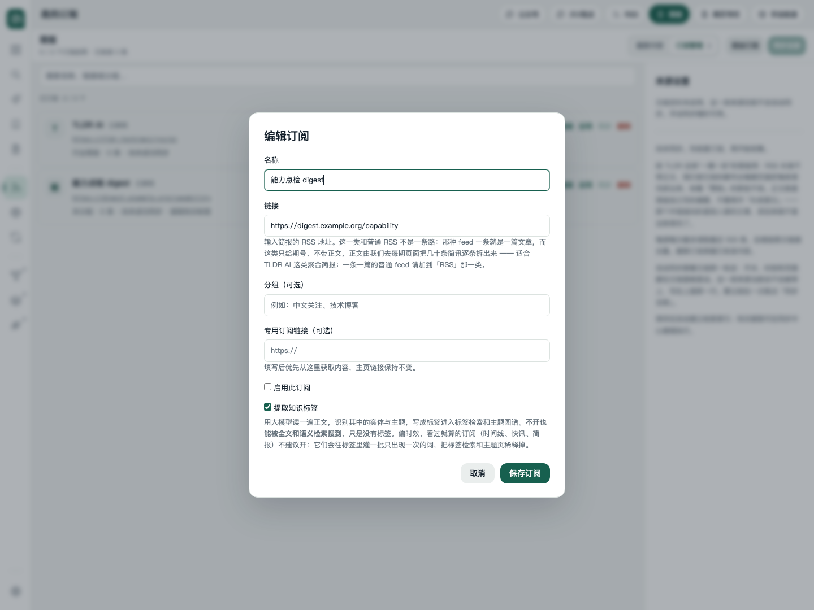
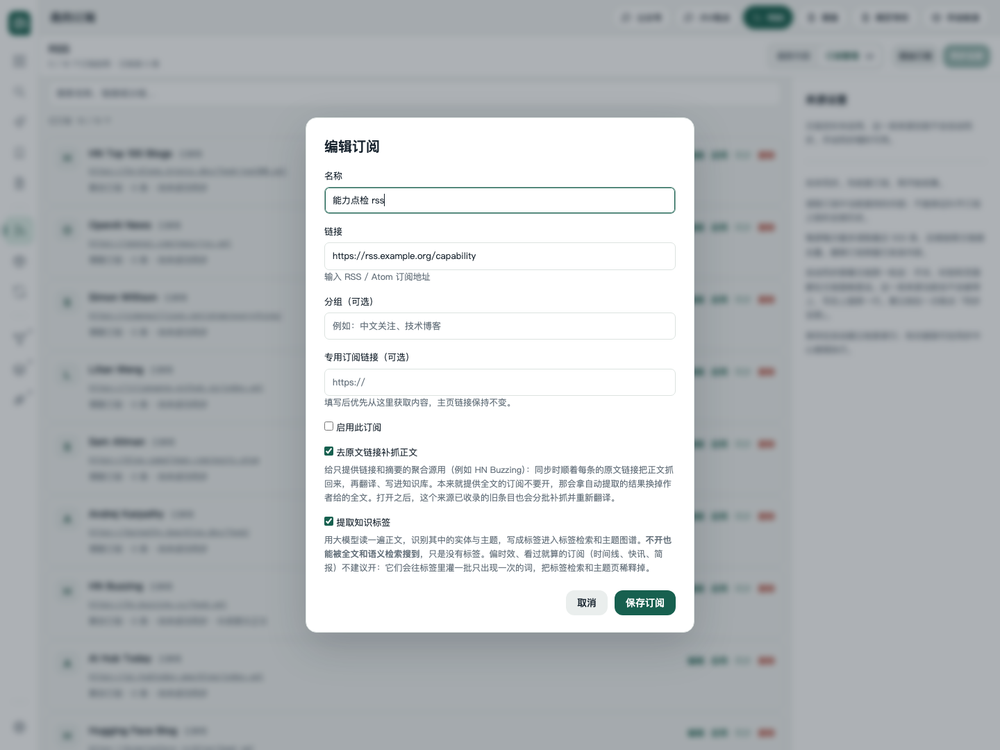

# 旧正文补抓的来源能力约束

## 范围与取舍

只处理独立转出的两条旧路径:自动补抓资格和订阅补抓开关。不改浏览器补抓入口、扩展、回执或原任务其他审查意见。
本任务基线为 `2fb0122`,尚无 `SourceType.body_from_link`,因此补入与既有界内修复相同的共享定义及 `permits_link_body()`:
默认关闭,RSS、网页专栏、手动收录显式开放。旧补抓和订阅保存共用这个能力判据。
原任务工作区未修改,也未重新开启原任务。

- 自动补抓的 `_eligible()` 同时检查条目和归属订阅的来源能力。补抓队列、挂起列表、恢复写入和翻译闸门仍共用它。
- 不适用来源即使在旧库中留着 `fulltext=1`,也不再被自动抓取,不会因历史挂起状态永久扣留英文摘要翻译。
- 订阅新建/编辑显式提交不适用的 `fulltext=true` 返回 400,不保存任何部分改动。
  不带该字段的正常编辑会把旧误开值收敛为关闭,其余选项保留;默认订阅种子同样受能力约束。
- 表单隐藏并禁用不适用的开关及说明,清掉旧勾选态,提交时再次按打开表单时的来源能力约束。
  在来源之间来回切换后,合法来源仍可正常勾选;订阅行不再显示失效的补抓标记。
- 不做批量数据迁移,不删除旧挂起记录,不猜测或恢复此前已被覆盖的正文。资格在使用时判定,不会替用户打开开关。

## 实际执行的检查

遵守项目约定,**未执行任何回归测试**,新增的 `tests/test_fulltext_capability.py` 仅写入并做语法检查,留给验收执行。
以下是静态检查、一次性缺陷冒烟和真实页面点检,不是测试套的通过记录。

```text
/Users/fjh/code/knowledge-base/.venv/bin/python -m py_compile \
    kb/source_types.py kb/feeds/fulltext.py kb/feeds/registry.py tests/test_fulltext_capability.py
node --check kb/static/js/source_forms.js
node --check kb/static/js/sources.js
git diff --check
```

上述检查均成功。修改后的代码文件均不超过 700 行。未安装 Ruff 的当前 venv 无法执行 Ruff 检查,未安装新依赖。

### 隔离接口与状态冒烟

用 `daemonize()` 和 `uv run --offline --no-sync` 启动实际应用,数据与 vault 都在本任务临时目录中;
全部订阅停用,调度器关闭,网络采集和模型调用均被拒绝。未访问生产库或启动真实管道。
一次性脚本直连实际 HTTP 路由,另在相同隔离库核对资格与挂起状态。补抓成功的正向对照仅替换 `fetch_one` 的取文结果,
队列、写回和翻译闸门使用实际代码,不证明网络提取或模型本身可用。

真实输出见 `evidence/fulltext-capability/smoke.json`:

- 简报旧开关为 1、条目带挂起原因:补抓待办为 0、请求次数为 0、挂起列表为空、恢复为 0;
  `unsettled=false`,翻译队列为真。原摘要、`summary` 类型、修订号 0、空补抓时间、尝试次数 0、旧挂起原因均未变。
- POST 新开简报补抓和 PATCH 显式开启均返回 400,原因是「简报不支持去原文链接补抓正文」。
  仅改订阅名返回 200、旧开关变 0,提取选择和停用状态保留。
- RSS 挂起时待抓为 0、正文未定、翻译不入队;重复 key 只恢复 1 条,重复恢复返回 0,恢复后待抓为 1。
  补抓实际写回后 `done=1`,正文与输入一致、类型为 `content`、修订号为 1、补抓时间非空、挂起清空,新正文可进入翻译队列。

### 浏览器通道与页面点检

第一级实际尝试了 Chrome 扩展:先命名「🔎 订阅补抓能力」会话,再请求新建 `visible:false` 标签。
扩展返回 **`Capability is not available: visibility`**,无法保证后台创建,因此停止该通道,没有改用可能激活窗口的默认新标签。
未接管用户现有标签,未连接用户 Chrome 调试端口,未激活窗口或切换标签。

按规范改用第二级独立 `chrome-headless-shell`,通过现有 `launchShell()` 管理临时 profile 和进程回收。
未安装 Playwright,没有有头浏览器,也不需要任何登录态。仅打开隔离服务并检查编辑弹窗,没有在浏览器里保存设置。

真实观察见 `evidence/fulltext-capability/browser.json`:

- 简报、大V观点:旧库开关为 1,但开关及说明隐藏、控件禁用且未勾选;订阅行不显示补抓标记,提取勾选保留。
- RSS、网页专栏、手动收录:控件可见、可用且保留已勾选状态,订阅行保留补抓标记。
- 简报切回 RSS 再打开编辑框,隐藏和禁用状态不串到合法来源。
- 390px 移动视口页面宽度与滚动宽度都是 390px,没有横向溢出;运行时 JS 异常为空。

最终代码版本重新启动隔离服务后重复上述点检,证据文件来自这次最终版本。收尾已关闭隔离服务与无头浏览器,
确认端口 63656 无监听、没有本任务服务或浏览器进程残留,并删除临时数据及 profile;扩展会话标签列表为空。





## 留给验收

新增回归覆盖旧误开值、直接 API 开启、部分编辑保留设置、默认种子、默认关闭能力、混合归属、补抓正向对照、翻译和挂起出口。
验收阶段执行 `tests.test_fulltext_capability`,并覆盖既有 `tests.test_feed_fulltext`、`tests.test_admit_three_ways`、
`tests.test_fulltext_held_exit`、`tests.test_fulltext_browser`、`tests.test_feed_sources`,再按项目统一闸门执行全量回归。
本任务不把这些尚未执行的用例报告为通过。
